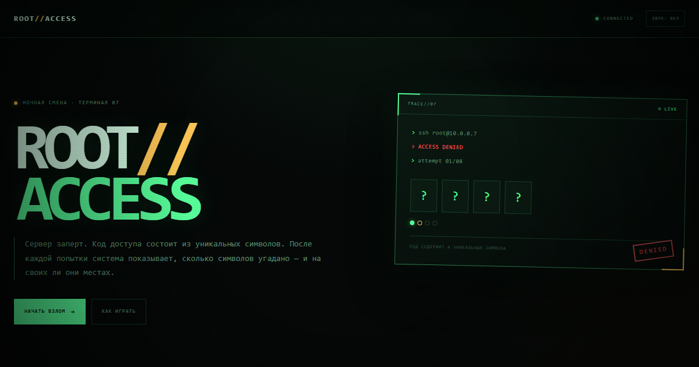

# ROOT//ACCESS

Логическая игра про ночной взлом сервера. Код доступа состоит из уникальных символов, а система после каждой попытки показывает, сколько символов угадано и на своих ли они местах.



## Играть

https://socdevvv.github.io/root-access/

## Правила

- На каждом уровне свой код, алфавит и количество попыток.
- Зелёная точка — символ на своём месте.
- Жёлтая точка — символ есть в коде, но стоит в другом месте.
- Пустая точка — символа в коде нет.
- Один «СКАН» на уровень открывает одну позицию, но снимает бонус за чистый взлом.
- Символы в коде не повторяются.

## Управление

- `Enter` — проверить код.
- `Backspace` — стереть последний символ.
- `S` — использовать скан.
- Символы можно вводить с клавиатуры или нажимать на клавиши терминала.
- Звук отключается кнопкой в шапке.

## Локальный запуск

Игра не требует сборки и зависимостей. Достаточно открыть `index.html` или запустить любой статический сервер:

```bash
npx serve .
```

## Технологии

- HTML5
- CSS3
- Vanilla JavaScript
- Web Audio API
- localStorage для лучшего счёта и настройки звука

## Деплой

Сайт публикуется через GitHub Pages из ветки `main`. Специальная сборка не нужна.
